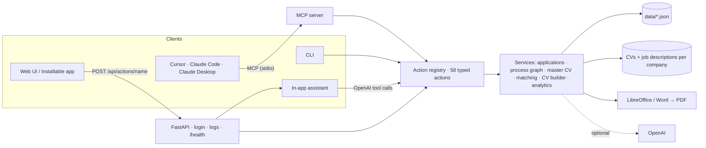

# Job Search Tracker

[](https://github.com/SamGuercho/job-search-tracker/actions/workflows/ci.yml)

A local web app to run a job search: follow every application through its process, keep one
**master CV** and generate a **one-page CV tailored to each job** (Word + PDF), with an optional
**AI assistant** that can do it all for you from a job link.

Everything runs on your computer. Your data stays in files on your disk; nothing is sent anywhere
unless you add an OpenAI key (then only the text needed for AI features goes to OpenAI).

---

## Contents
1. [Quick start](#quick-start)
2. [First steps](#first-steps)
3. [What you can do](#what-you-can-do)
4. [Use it from Cursor / Claude (MCP)](#use-it-from-cursor--claude-mcp)
5. [Your data and privacy](#your-data-and-privacy)
6. [Configuration](#configuration)
7. [Troubleshooting](#troubleshooting)
8. [For developers](#for-developers)

---

## Quick start

**You need**
- **Python 3.11+** (`python3 --version`). macOS: `brew install python` or python.org. Windows: python.org.
- **For PDF export** (optional but recommended), one of:
  - **LibreOffice** (free, recommended): `brew install --cask libreoffice` on macOS, or libreoffice.org.
  - **Microsoft Word** (macOS/Windows). The first export asks permission to control Word: accept it.
  Without either, you still get the Word file; the one-page fit is then estimated.
- **For AI features** (optional): an OpenAI API key — see [Configuration](#configuration).

**Install and run (macOS / Linux)**
```bash
git clone <this repository's URL> job-search-tracker
cd job-search-tracker
./run.sh
```
Open **http://127.0.0.1:8000**. The first run creates a virtual environment, installs the dependencies
and creates your `.env` file. Stop the app with `Ctrl+C`; run `./run.sh` again to restart it.

**Windows** (PowerShell)
```powershell
git clone <this repository's URL> job-search-tracker
cd job-search-tracker
py -m venv .venv
.venv\Scripts\pip install -r requirements.txt
copy .env.example .env
.venv\Scripts\python -m jobtracker serve --port 8000
```

**Or with Docker** (nothing else to install: LibreOffice and the CV font are in the image)
```bash
git clone <this repository's URL> job-search-tracker
cd job-search-tracker
cp .env.example .env        # optional: OpenAI key, password…
docker compose up --build
```
Open **http://127.0.0.1:8000**. Data stays in `./data` (shared with `./run.sh`), CVs go to `./output`
(or `HOST_OUTPUT_DIR` in `.env`). Linux hosts: the container runs as user id 10001, so give it write access
to `./data` and `./output` (e.g. `sudo chown -R 10001 data output`).

**Updating:** `git pull`, then `./run.sh` (new dependencies are installed automatically) or
`docker compose up --build`.

**On your phone:** the app is installable (home-screen icon, full screen). Make it reachable from your phone
(same network with `JOBTRACKER_HOST=0.0.0.0`, or a private network such as Tailscale), **set
`JOBTRACKER_PASSWORD` first**, open it in the phone's browser and choose *Install app* / *Add to Home Screen*.
Installing needs https or localhost; over plain http on your network it still works as a web page.

---

## First steps

The app starts with **example data** (a fictional "Your Name" CV and two sample applications) so the
pages aren't empty. Replace it with yours:

1. **Your CV** → *Master CV* tab.
   - With an OpenAI key: **Import from CV file** (.docx / .pdf), review the result, choose *Replace*.
   - Without: fill in Profile, then add your experiences and their bullet points by hand.
   - Fill **Position (shown under your name)** and your **LinkedIn URL**.
2. **Delete the two sample applications** (open each from *Follow-up* → *Delete*).
3. **Choose where CVs are saved** (default: the `output/` folder of the app): set `JOBTRACKER_OUTPUT_DIR`
   in `.env`, e.g. a folder in iCloud Drive or Dropbox, then restart.
4. **Optional:** add your `OPENAI_API_KEY` in `.env` and restart to enable the assistant and AI features.

Then add your first application with **+ Add company** (paste the job description) or ask the assistant
"*Add this job and make my CV: <link or text>*".

---

## What you can do

### Follow-up (home page)
One row per application: status and current step, days since the last update (by you or them), location
(📍 opens Google Maps) and work model, salary, source, keywords, main qualities, contact, referee,
seniority. Sort by any column, search (including keywords), filter by status or work model, choose the
visible columns (**Columns**), and log a follow-up in one click. The chat bar sends a request to the assistant.

### Application page
- **Process graph** — default steps *Applied → Response received → First HR interview → Reference check*,
  plus a red **Rejected / Closed** node every step can lead to. Click a step to turn it Off / Planned / Done,
  date it, add notes, set its type; **+** on a link inserts a step there; **⑂ Branch** adds a parallel path.
  The application's **status is computed from the graph** (Not applied, Applied, In process, Offer, Rejected).
- **CV summary** — the paragraph at the top of the CV, tailorable per application, with an AI relevance check.
- **Details** — position, location/address, work model, job posting link, source, salary (yours and posted),
  contact, referee, qualities, notes, keywords, job description.
- **Job description** — saved as `Job_Description.md` in the company's folder, so you keep it when the posting
  disappears. Updated when you change it; older copies go to `archive/`.
- **Generated CVs**, map, follow-up log.

### CV builder (a CV for one job)
Pick the application or paste the job description → **Find matching keywords**: each requirement of the
ad is matched to the words **actually written in your CV** (same word, synonym, or AI), with the
requirements your CV doesn't cover listed as gaps. The preview shows which achievements are used and why;
**Create CV** writes `<Company>/<Your_Name>_CV.docx` and `.pdf`, trimmed to one page.

### Master CV
Your whole career, as **achievements** (one fact each) with keywords. An achievement can have several
**wordings** (same facts, different keywords); a CV uses at most one wording per achievement, so nothing
is repeated. Keywords only count when they are written in the text (✓/✗ shown live).
**✨ Draft wordings with AI** proposes rewordings that never add facts or numbers; nothing is saved until
you click *Keep*. **📄 Create general CV** makes a CV for no job in particular (headhunters, networking),
saved in a `Master CV` folder. Also: education, skills, languages, synonyms, extra keywords to watch.

### Analytics
Applications sent, response rate, interviews (incl. technical), offers, days searching, time to a response,
funnel, where applications stop, applications per week, results by source and work model.

### Assistant (needs an OpenAI key)
A chat that uses the app's features for you: add a job from a link or pasted text (company, details, saved
description, tailored CV, gaps), update process steps ("I got an HR call for Monday 10am"), list follow-ups,
review your summary, interview you to grow your master CV, show analytics. Anything that **deletes or
overwrites data, or adds text to your CV, waits for your Approve / Reject**. Conversations are titled
"Company · stage" automatically.

---

## Use it from Cursor / Claude (MCP)

The app is also an **MCP server**: AI tools like Cursor, Claude Code or Claude Desktop get every feature as a
tool (52 of them: add an application, update its process, generate a CV, analytics…), with the same data as
the web app. Example prompts once connected: *"Add this job to my tracker and make my CV: <text>"*,
*"I had the HR interview with Nimbus today"*, *"Which applications need a follow-up?"*.

1. Install the app once (`./run.sh`, see Quick start), then print the configuration for your machine:
   ```bash
   .venv/bin/python -m jobtracker mcp-config
   ```
2. Add it to your tool:
   - **Cursor**: Settings → MCP → *Add new MCP server*, or paste the printed JSON into `~/.cursor/mcp.json`
     (merge it into `mcpServers` if the file already exists).
   - **Claude Code**: run the printed `claude mcp add …` command.
   - **Claude Desktop**: Settings → Developer → *Edit Config*, paste the JSON, restart Claude Desktop.
3. The client starts the server itself when needed; the web app doesn't have to be running.

Tools that delete or overwrite data, or add text to your CV, are flagged *destructive* and tell the AI to ask
you first; most clients also ask for your confirmation before any tool call. The AI-powered tools (matching,
drafts, reviews, import) use the `OPENAI_API_KEY` from `.env`. Pair it with the instructions in
`skills/job-search/SKILL.md` (Claude Code: copy the folder to `~/.claude/skills/`).

---

## Your data and privacy

| What | Where | In git? |
|---|---|---|
| Master CV, applications, chats | `data/*.json` (or `JOBTRACKER_DATA_DIR`) | **No** (ignored) |
| Backups made by the app, uploaded CVs | `data/backups/`, `data/uploads/` | **No** |
| Generated CVs, saved job descriptions | `output/<Company>/` (or `JOBTRACKER_OUTPUT_DIR`) | **No** |
| OpenAI key, local paths | `.env` | **No** |
| Example data for new users | `data/seed/` | Yes (fictional) |

- Files are never overwritten silently: a regenerated CV or changed job description moves the previous one
  to `archive/`.
- **Sent to OpenAI** (only with a key, only when you use an AI feature): the text of the CV you import, your
  master CV and the job description when matching/reviewing/drafting, and your chat messages. Nothing else.
- To back up your data, copy the `data/` folder (or point `JOBTRACKER_DATA_DIR` to a synced folder).

---

## Configuration

All settings live in `.env` (created from `.env.example` on first run). Restart after a change.

| Setting | Default | Purpose |
|---|---|---|
| `OPENAI_API_KEY` | empty | Enables the assistant and AI features. Keys: platform.openai.com/api-keys. Usage is billed by OpenAI, typically cents per action. |
| `OPENAI_MODEL` | `gpt-5.4-mini` | Model for import, matching, drafts, reviews. |
| `OPENAI_CHAT_MODEL` | = `OPENAI_MODEL` | Model for the assistant (a stronger one gives better conversations). |
| `JOBTRACKER_OUTPUT_DIR` | `./output` | Where company folders with CVs and job descriptions go. `~` allowed. |
| `JOBTRACKER_DATA_DIR` | `./data` | Where your data files live. |
| `JOBTRACKER_CV_FILENAME` | `{name}_CV` | CV file name; `{name}` = your name, `{company}` = the company. |
| `JOBTRACKER_PDF_ENGINE` | auto | `libreoffice`, `word` or `none`. |
| `JOBTRACKER_PASSWORD` | empty | When set, every page and API call requires signing in (signed, HTTP-only session cookie). |
| `JOBTRACKER_SESSION_DAYS` | `30` | How long a sign-in lasts. Changing the password signs everyone out. |
| `JOBTRACKER_HOST` / `PORT` | `127.0.0.1` / `8000` | Where the server listens (`0.0.0.0` to reach it from other devices: set a password). |
| `LOG_FORMAT` / `LOG_LEVEL` | `text` / `INFO` | `json` writes one JSON object per request (method, path, status, duration). |

The CV font is **STIX Two Text** (included in macOS). On Windows/Linux, install it from
github.com/stipub/stixfonts for the PDF to look identical; otherwise a similar serif font is used.

---

## Troubleshooting

- **No PDF, only Word** → install LibreOffice (recommended) or set `JOBTRACKER_PDF_ENGINE`. With Word on macOS,
  a "control Microsoft Word" permission dialog may be waiting: accept it, then restart the app.
- **"OPENAI_API_KEY is not set"** → add it to `.env` and restart.
- **Port 8000 already used** → `PORT=8001 ./run.sh`.
- **A job link can't be read** → some sites (LinkedIn…) block it: paste the job text instead.
- **Page looks outdated after an update** → reload the page.
- **Undo a deletion** → deletions in the app are final; keep a copy of `data/` (see
  [Your data and privacy](#your-data-and-privacy)). To restore one, stop the app and copy it back.

---

## For developers

### Architecture


```
jobtracker/
  models.py, process.py   data models; process graph (steps, links, derived status) 
  storage.py              atomic JSON persistence (swap for a database here)
  registry.py             @action decorator: one typed function = API endpoint + CLI command + AI tool
  actions.py              every operation of the app, as named actions
  services/               business logic (no HTTP): companies, master_cv, cv_builder, jd_match, wording,
                          summary, analytics, cv_import, assistant, llm, pdf, files, web
  cv_templates/           Word templates (elegant.py); add one and register it in __init__.py
  api.py                  FastAPI: POST /api/actions/<name>, GET /api/actions, /files/…, /health, the web UI
  auth.py, logs.py        optional password login; request logging (text or JSON)
  __main__.py             CLI
  mcp_server.py           MCP server: one tool per action, generated from the registry
web/                      vanilla JavaScript UI, no build step (js/views/<page>.js)
skills/job-search/        SKILL.md: instructions for AI agents (e.g. Claude Code)
tests/                    unit tests (no network; OpenAI is stubbed)
```

### Actions = API = CLI = agent tools
Every feature is a function in `actions.py` decorated with `@action("group.verb")`. Its signature becomes the
JSON schema and its docstring the description, so it is automatically:
- an HTTP endpoint: `POST /api/actions/company.create` with a JSON body;
- a CLI command: `.venv/bin/python -m jobtracker company.create '{"name": "Acme"}'`;
- a tool of the in-app assistant (`@action(..., confirm=True)` makes it wait for the user's approval);
- an MCP tool (`process_set_state`…), flagged destructive when `confirm=True` and read-only when listed in
  `READ_ONLY` in `jobtracker/mcp_server.py`.

```bash
.venv/bin/python -m jobtracker help        # list actions
.venv/bin/python -m jobtracker actions     # JSON schemas (e.g. to expose them as MCP tools)
```
External agents: connect over MCP (above) or use the CLI, with `skills/job-search/SKILL.md` as their guide.

### Tests, lint, CI
```bash
.venv/bin/python -m unittest discover -t . -s tests
.venv/bin/pip install ruff && .venv/bin/ruff check .
```
Tests always run on throwaway folders: `tests/__init__.py` configures them before the app is imported and every
test checks it, so they can never touch your data, your output folder or `.env`. They never call OpenAI and
don't need a PDF engine.

**CI** (`.github/workflows/ci.yml`, GitHub Actions): on every push and pull request, lint (ruff) and tests on
Python 3.11 and 3.13; on `main`, build the Docker image, start it and check `/health` (including the PDF engine),
then publish it to the GitHub Container Registry as `ghcr.io/<owner>/job-search-tracker:latest`.

### Docker image
`Dockerfile`: Python 3.13 slim + LibreOffice (PDF export) + STIX Two Text (pinned release) · non-root user ·
`/data` and `/output` volumes · health check on `/health` · JSON logs. `compose.yaml` runs it locally on the same
`./data` folder as `./run.sh`.
